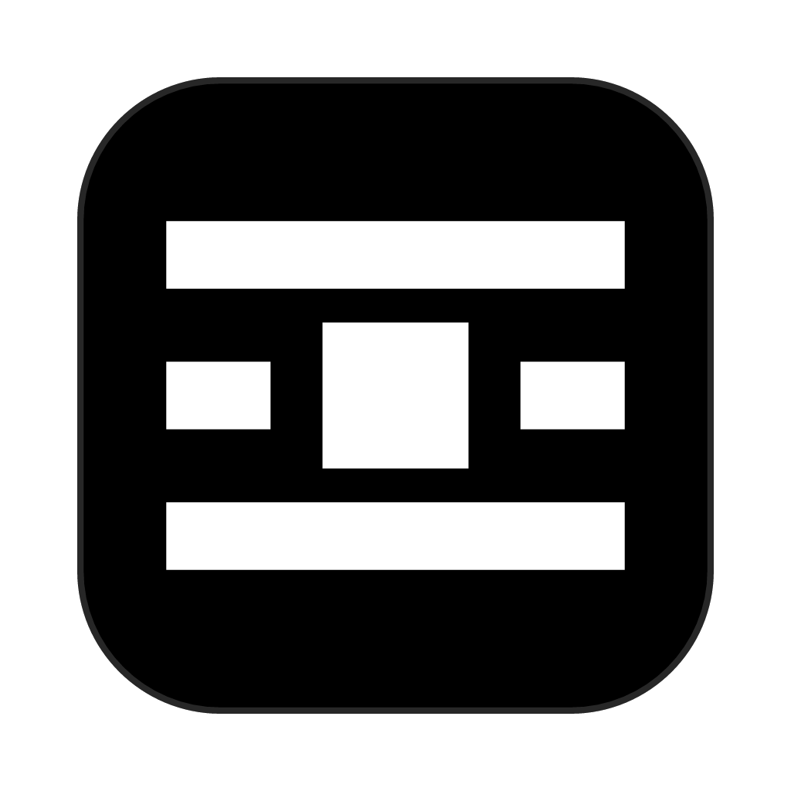

<p align="center">
  
</p>

<h1 align="center">Vey Lens</h1>

A desktop database explorer you can talk to. Connect to PostgreSQL or MySQL
— or open Excel, CSV and Google Sheets as tables — browse and edit them like
in any database client, and ask questions about your data in plain language:
Claude reads the schema, runs the SQL, and shows what it found.

Electron + React, built the same way as [Vey](../vey): esbuild for the main
process, Vite for the renderer, one typed IPC contract between them, and
Vey's shadcn components (`base-nova` on Base UI) and stylesheet for the UI.

## Run it

```bash
bun install
bun run dev        # builds main, starts Vite, opens the window
```

The chat runs the `claude` CLI already on your machine, signed in as you
(install it and run `claude` once to log in). `CLAUDE_BIN` points it at a
custom install. Without it, the explorer and viewer still work.

No database handy? `bun run demo:pg` starts a small sample Postgres on
`127.0.0.1:54329` (user/password `postgres`, database `postgres`, SSL off).

Google Cloud SQL works without the Cloud SQL Auth Proxy — pick **Google
Cloud SQL** in the connection dialog and give the instance connection name
(`project:region:instance`). It signs in to Google with this machine's
Application Default Credentials.

```bash
bun run test       # drivers + analysis features against an in-process Postgres
bun run typecheck
bun run build      # dist-electron/ + dist-renderer/
bun run package    # electron-builder → release/
```

## What it does

- **Explorer** — saved connections, schemas, tables and views, search; each
  connection can be given a colour (e.g. red for production).
- **Files & Google Sheets** — a *Files* connection reads Excel (.xlsx, .xls),
  CSV, Parquet, JSON and Google Sheets into an in-process DuckDB: a workbook
  is a schema with a table per sheet, other files are tables in `main`. The
  header is found under a title, merged cells are filled, columns are typed
  from the cells, Shift_JIS CSV is read as such. Files are re-read when they
  change, sheets every five minutes. Read-only, and DuckDB can reach no file
  but the ones given. A Google Sheet is read by its "anyone with the link"
  export, or — for one shared with you — through the Sheets API as the
  account signed in with **Sign in with Google** (read-only Sheets scope,
  refresh token in the keychain), else this machine's gcloud Application
  Default Credentials. Signing in needs a Google OAuth client of type
  *Desktop app* (an *Internal* one in a Workspace needs no Google review):
  built in with `VEYLENS_GOOGLE_CLIENT_ID` / `VEYLENS_GOOGLE_CLIENT_SECRET`
  set when building (release.yml reads them from repository secrets), or
  imported in the app from its `client_secret_….json`. Enable the Google
  Sheets API in the client's project.
- **Viewer** — table tabs with paging, sorting, filtering and inline
  editing (⌘S saves everything in one transaction); SQL tabs run arbitrary
  queries (⌘↵).
- **Formatted values & field settings** — cells render like NocoDB/Airtable
  (tags, links, FK chips, booleans, thumbnails…), with per-column options
  (number, currency, percent, date/time, select, rating, and more).
- **Chat** — a Claude Code session per conversation with database tools and
  nothing else (no shell, no files, no web): it can query, chart, diagnose
  changes, and propose writes for your approval.
- **Charts & dashboards** — the agent draws charts in chat (bars, lines,
  KPIs, pivots…) and can pin them to dashboards with filters, drill-downs
  and scheduled refresh.
- **Schema diagram** — a schema's tables and the foreign keys between them,
  laid out parents-first; pan, zoom, drag tables, find one, double-click to
  open it. Keys a database never declared can be inferred from names
  (`customer_id` → `customers.id`) and are drawn dashed. Copies as a Mermaid
  `erDiagram`. Hidden tables stay hidden.
- **Alerts** — a query that returns one number, checked read-only in the
  background on its own schedule; a system notification when it goes above
  or below a threshold, or moves by a percentage between checks. Started
  from scratch, from a metric, or by asking the assistant, which can also
  change, pause and delete them — each with your approval.
- **Business context** — per-connection notes and named metrics the agent
  reads before answering questions.
- **Skills** — reusable instructions for how the assistant should handle a
  kind of task, built-in or your own.
- **Gateways** — a local port that forwards to a chosen saved connection,
  so an app's `.env` never has to change.
- **Audit log** — every statement, edit and refusal made through the app.

## Keeping the agent in its lane

- Reads run in a read-only transaction; only `execute_sql` / `execute_plan`
  can write, and both show you the exact SQL and wait for approval.
- Approvals are re-checked in the main process, so a CLI configured to skip
  prompts still fails closed.
- Each connection has an access mode (**Read & write**, **Confirm writes**,
  **Read only**) plus finer per-statement and per-table/schema permissions
  and guard rails (no WHERE-less writes, row limits, timeouts) — enforced in
  the agent's tools, the driver, and the database session itself.

## Layout

```
src/shared/api.ts      the IPC contract: types + channel names, nothing else
src/preload/index.ts   the bridge (`window.veylens`)
src/main/
  main.ts              window, wiring
  ipc.ts               one handler per contract method
  connections.ts       saved connections (passwords via the OS keychain)
  db/                  Driver interface; postgres.ts, mysql.ts, sql.ts;
                       files/ — Excel, CSV, Sheets in DuckDB
  chats.ts             conversations and the `claude` session behind each
  agent-tools.ts       the tools the agent is given
  assist.ts            SQL assist: one-shot Generate / Explain / Fix
  library.ts           notes, metrics and dashboards (`library.json`)
src/shared/chart.ts    what can be charted, shared by the agent and the viewer
src/shared/params.ts   dashboard filters as SQL parameters; date presets
src/renderer/          React app: Explorer, Viewer, ChatPanel, Chart
  components/ui/       shadcn components, copied from Vey
  styles/              Vey's globals.css + motion.css; app-only styles in index.css
```

Adding a call across the bridge means touching `api.ts`, the preload and
`ipc.ts` — the type on `DesktopApi` makes the compiler point at whichever one
was missed.

Data lives in Electron's `userData` directory (`VEYLENS_HOME` overrides it):
`connections.json`, `library.json`, `alerts.json` and `chats/`.
